<div align="center">

<!-- Hero Banner (Assets folder relative path; renders automatically in repository) -->
<a href="https://github.com/Irfanexe09">
  
</a>

<br/><br/>

# Shaik Irfan

**Undergraduate Developer &bull; AI/ML &bull; Applied Software Systems**  
*B.Tech in Computer Science & Engineering (AI & ML) &bull; Presidency University, Bengaluru (2025–2029)*

[](https://github.com/Irfanexe09)
[](https://www.linkedin.com/in/shaikirfan09/)
[](mailto:shaikirfan2018@gmail.com)
[](https://www.instagram.com/exepirate/)
[](mailto:shaikirfan2018@gmail.com)

<br/>

</div>

---

### ⚡ Engineering Identity & Overview

I am a computer science undergraduate specializing in **Artificial Intelligence and Machine Learning** at **Presidency University, Bengaluru**. My engineering focus centers on **applied AI systems, retrieval-augmented generation (RAG), backend API development, and privacy-preserving intelligent software**.

Rather than relying on generic LLM wrappers, my work emphasizes **deterministic architectural boundaries**—combining machine learning perception with strict mathematical verification, local on-device privacy isolation, and multi-tenant data integrity. I enjoy building functional prototypes, writing clean schemas and test suites, and solving practical engineering problems.

```
┌────────────────────────────────────────────────────────────────────────────────────────┐
│  Academic Base       : Presidency University, Bengaluru (2025–2029)                    │
│  Specialization      : B.Tech Computer Science & Engineering (AI & ML)                 │
│  Core Focus Areas    : Applied AI Engineering, Deterministic RAG, Backend Systems      │
│  Current Milestone   : Building verifiable prototypes & seeking summer internships     │
└────────────────────────────────────────────────────────────────────────────────────────┘
```

---

## 🛠️ Featured Engineering Projects

```
[01] NutriLens  ──►  [02] AEGIS  ──►  [03] TrustLayer  ──►  [04] AI Study Copilot
                       │                     │
                       ▼                     ▼
             [05] Medical Drone    [06] Result System
```

<br/>

### 01. NutriLens &mdash; Multimodal Nutrition Intelligence Engine

<table width="100%">
  <tr>
    <td align="left">
      <strong>🥗 NutriLens</strong> &nbsp;|&nbsp; <code>Completed Prototype</code> &nbsp;|&nbsp; <code>88 Tests Passed</code>
    </td>
    <td align="right">
      <a href="https://github.com/Irfanexe09/nutrilens-ai">
        
      </a>
    </td>
  </tr>
  <tr>
    <td colspan="2">
      <p><strong>An AI-assisted nutrition tracking application that decouples visual food identification from deterministic macronutrient computation.</strong></p>
      <p><strong>Core Technical Contribution:</strong> Solves the widespread flaw where vision-language models hallucinate arbitrary calorie numbers. NutriLens enforces a strict architectural boundary: multimodal vision models only suggest food candidates, which the user reviews and confirms. A deterministic Python backend engine then performs exact mathematical calculations against verified nutritional databases, returning macro totals with honest statistical uncertainty intervals reflecting real-world cooking variance.</p>
      <p><strong>Deterministic Engine Architecture:</strong></p>
      <pre><code>Confirmed Food ──► Structured DB Lookup ──► Nutrition / Unit ──► Portion Conversion (0.25x–3.0x) ──► Deterministic Math Engine ──► Meal Totals (±10–15% Bounds)</code></pre>
      <p>
        <strong>Implemented Functionality:</strong> Multimodal food candidate classification, portion confirmation workflows, daily meal logging, nutritional history tracking, and user anthropometric profiling (body weight, height, macro targets).<br/>
        <strong>Verified Datasets:</strong> Indian food composition data referenced from <strong>ICMR-NIN IFCT 2017</strong> (Indian Food Composition Tables) and global items from <strong>USDA FoodData Central</strong>.<br/>
        <strong>Quality &amp; Testing:</strong> 88 automated unit, database, and integration tests passed across schemas, calculation rules, and API endpoints.
      </p>
      <p>
        <strong>Technology Stack:</strong><br/>
        
        
        
        
        
        
        
        
        
      </p>
      <p><sub><em>Note: Developed as an engineering prototype with strict mathematical verification; does not claim clinical validation or production deployment.</em></sub></p>
    </td>
  </tr>
</table>

<br/>

### 02. AEGIS &mdash; On-Device Privacy Layer for Browser AI Agents

<table width="100%">
  <tr>
    <td align="left">
      <strong>🛡️ AEGIS</strong> &nbsp;|&nbsp; <code>5th Place &bull; SIH 2026 Internal Selection</code> &nbsp;|&nbsp; <code>Completed Prototype</code>
    </td>
    <td align="right">
      <a href="https://github.com/Irfanexe09/AEGIS">
        
      </a>
    </td>
  </tr>
  <tr>
    <td colspan="2">
      <p><strong>A privacy-first Chrome extension layer that sanitizes visual and textual browser context on-device before handing it to AI agents.</strong></p>
      <p><strong>Core Technical Contribution:</strong> Autonomous browser agents conventionally capture full-viewport screenshots, inadvertently exposing sensitive credentials, human faces, and personally identifiable information (PII) to remote vision-language models. AEGIS introduces an uncompromising on-device redaction boundary: before any screen data leaves the machine, local models detect and redact sensitive coordinates directly inside isolated Web Workers and offscreen canvas documents.</p>
      <p><strong>On-Device Privacy Pipeline:</strong></p>
      <pre><code>Tab Viewport Capture ──► Inference Web Worker (ONNX WASM) ──► BlazeFace + DistilBERT NER ──► Offscreen Canvas Masking ──► Sanitized Context to Agent / Local LLM</code></pre>
      <p>
        <strong>Implemented Functionality:</strong> Local face detection via BlazeFace, textual PII detection (emails, contact numbers, national IDs) via DistilBERT NER in ONNX WebAssembly, password/secret DOM element masking, and client-side credential vault in IndexedDB.<br/>
        <strong>Evaluation &amp; Milestone:</strong> Tested against TP01–TP08 automated evaluation harnesses verifying redaction precision without freezing the main browser thread.<br/>
        <strong>Hackathon Recognition:</strong> <strong>5th Place</strong> in the Smart India Hackathon 2026 Internal Selection Round at Presidency University (Team AEGIS X &bull; Problem Statement SIH26171 &bull; Team ID 161035).
      </p>
      <p>
        <strong>Technology Stack:</strong><br/>
        
        
        
        
        
        
        
        
      </p>
      <p><sub><em>Note: Built and benchmarked as a research prototype for SIH 2026 internal rounds; local inference runs client-side on consumer hardware.</em></sub></p>
    </td>
  </tr>
</table>

<br/>

### 03. TrustLayer &mdash; Enterprise Knowledge Copilot

<table width="100%">
  <tr>
    <td align="left">
      <strong>🏛️ TrustLayer</strong> &nbsp;|&nbsp; <code>Completed Prototype</code> &nbsp;|&nbsp; <code>Mini SIH Collaboration</code>
    </td>
    <td align="right">
      <a href="https://github.com/MrEGAMERZ/TrustLayer">
        
      </a>
    </td>
  </tr>
  <tr>
    <td colspan="2">
      <p><strong>A retrieval-augmented generation (RAG) knowledge assistant engineered to provide verified, grounded answers from dense enterprise documentation with hallucination guardrails.</strong></p>
      <p><strong>Core Technical Contribution:</strong> Replaces ungrounded LLM question-answering with verifiable document tracing. Ingests high-page-count policy and engineering manuals, extracts structured text blocks with structural preservation using PyMuPDF, maps semantic representations into 768-dimensional space via Sentence-BERT, and indexes them in FAISS. Response generation with Llama 3.3 is restricted strictly to retrieved chunks with sentence-level citation tracking and cosine similarity validation.</p>
      <p><strong>Document Verification Flow:</strong></p>
      <pre><code>Enterprise PDF Ingestion (PyMuPDF) ──► Structural Chunking ──► Sentence-BERT (768-dim) ──► FAISS Vector Index ──► Grounded Llama 3.3 Synthesis + Hallucination Check</code></pre>
      <p>
        <strong>Implemented Functionality:</strong> Batched PDF chunk processing, cosine similarity scoring against source vectors to flag potential synthesis drift, multi-document conflict detection, and strict out-of-context refusal boundaries.<br/>
        <strong>Collaborative Context:</strong> Developed for Mini SIH at Presidency University with Team InclusionX.
      </p>
      <p>
        <strong>Technology Stack:</strong><br/>
        
        
        
        
        
        
        
        
      </p>
      <p><sub><em>Note: Architecture emphasizes strict retrieval bounding; claims avoid fabricated benchmarks or synthetic performance statistics.</em></sub></p>
    </td>
  </tr>
</table>

<br/>

### 04. AI Study Copilot &mdash; Curriculum-Grounded Learning Workspace

<table width="100%">
  <tr>
    <td align="left">
      <strong>📚 AI Study Copilot</strong> &nbsp;|&nbsp; <code>Active Development</code> &nbsp;|&nbsp; <code>13-Suite Evaluation Harness</code>
    </td>
    <td align="right">
      <a href="https://github.com/irfanexe09/AI-Study-Copilot">
        
      </a>
    </td>
  </tr>
  <tr>
    <td colspan="2">
      <p><strong>A course-grounded study companion that transforms textbooks, lecture slides, and syllabi into interactive learning workspaces with verified citations, quizzes, and active recall flashcards.</strong></p>
      <p><strong>Core Technical Contribution:</strong> Prevents inter-course data leakage and retrieval drift through PostgreSQL Row-Level Security (RLS) multi-tenant isolation and hybrid search. Ingests multi-format course materials (PDF, PPTX, DOCX) via Docling and PyMuPDF4LLM into 512-dimension normalized embeddings. Combines dense semantic vector search with keyword search via Reciprocal Rank Fusion (RRF) to retrieve both conceptual definitions and precise engineering acronyms.</p>
      <p><strong>Curriculum Ingestion &amp; Study Pipeline:</strong></p>
      <pre><code>Course Material (PDF/PPTX/DOCX) ──► Docling &amp; PyMuPDF ──► pgvector HNSW Index ──► Reciprocal Rank Fusion (RRF) ──► SSE Grounded Chat + Tamper-Proof Quizzes</code></pre>
      <p>
        <strong>Implemented Functionality:</strong> Multi-format slide and textbook parsing, conversational query rewriting resolving pronouns across multi-turn chats, Server-Sent Events (SSE) streaming with KaTeX LaTeX math formula rendering, tamper-proof client-side quizzes evaluated server-side, and 3D interactive flashcards.<br/>
        <strong>Security &amp; Evaluation:</strong> 13-suite automated test harness verifying RLS tenant security (zero cross-user data exposure), retrieval accuracy, and API error resilience.
      </p>
      <p>
        <strong>Technology Stack:</strong><br/>
        
        
        
        
        
        
        
        
        
      </p>
      <p><sub><em>Note: Active development repository with automated test verification; no live cloud deployment is hosted at this stage.</em></sub></p>
    </td>
  </tr>
</table>

<br/>

### Applied Systems &amp; Coursework Projects

<table width="100%">
  <tr>
    <td width="50%" valign="top">
      <h4>05. Autonomous Medical Supply Drone</h4>
      <p><code>Hardware &amp; Robotics Concept</code> &bull; <code>Student Prototype</code></p>
      <p><strong>A student engineering exploration into autonomous quadcopter delivery of critical lightweight medical supplies to disaster-affected and isolated regions.</strong></p>
      <p><strong>Core Concept:</strong> Focuses on autonomous waypoint mission execution, payload stabilization, and obstacle sensing without requiring constant manual radio control.</p>
      <ul>
        <li>Pixhawk 2.4.8 flight controller running ArduPilot</li>
        <li>ESP32 microcontroller telemetry and sensor telemetry</li>
        <li>GPS waypoint navigation and failsafe return-to-launch (RTL)</li>
        <li>Brushless DC motors (BLDC) and 30A electronic speed controllers (ESCs)</li>
      </ul>
      <p><sub><em>Note: An academic engineering study and hardware prototype; not a certified or production medical transport vehicle. Repository details maintained in hardware build logs.</em></sub></p>
    </td>
    <td width="50%" valign="top">
      <h4>06. Student Result Management System</h4>
      <p><code>Systems Programming</code> &bull; <code>Academic Coursework</code></p>
      <p><strong>A modular academic record and examination result management software system designed in Python.</strong></p>
      <p><strong>Core Concept:</strong> Automates student record handling, examination marks recording, weighted grade point average (GPA) calculations, and academic summary generation.</p>
      <ul>
        <li>Structured student database records with unique roll-number validation</li>
        <li>Automated GPA / SGPA calculation algorithms and grading logic</li>
        <li>Subject-wise statistical performance aggregation</li>
        <li>Persistent file-based / SQLite data storage and search retrieval</li>
      </ul>
      <p><sub><em>Note: Core university coursework software engineering project. Source code structure cataloged in academic coursework archives.</em></sub></p>
    </td>
  </tr>
</table>

---

## 🏆 Key Achievements & Milestones

<table width="100%">
  <thead>
    <tr>
      <th align="left" width="25%">Milestone</th>
      <th align="left" width="50%">Description &amp; Verification Context</th>
      <th align="left" width="25%">Institution / Organization</th>
    </tr>
  </thead>
  <tbody>
    <tr>
      <td><strong>5th Place &bull; SIH 2026 Internal Selection</strong></td>
      <td>Secured 5th place in the university-wide internal selection round for <strong>Smart India Hackathon 2026</strong> with project <strong>AEGIS</strong> (Problem Statement SIH26171 &mdash; On-device Visual Perception for Light-weight Browser Agents). Team AEGIS X (Team ID: 161035).</td>
      <td><strong>Presidency University, Bengaluru</strong><br/><em>September 2026</em></td>
    </tr>
    <tr>
      <td><strong>Introduction to Artificial Intelligence</strong></td>
      <td>Completed formal certification covering core AI fundamentals, state-space problem formulation, uninformed search (BFS, DFS), and informed heuristic search algorithms (A*, Greedy Best-First).</td>
      <td><strong>Infosys Springboard</strong><br/><em>Completed September 2026</em> <sup>[1]</sup></td>
    </tr>
  </tbody>
</table>

<p><sub><em>[1] Credential reference maintained in coursework archives; subject to institutional certificate verification.</em></sub></p>

---

## 💻 Technical Stack & Engineering Capabilities

To maintain engineering integrity, technologies are explicitly categorized by actual implementation status across my projects versus concepts actively being mastered.

<table width="100%">
  <thead>
    <tr>
      <th align="left" width="30%">Domain</th>
      <th align="left" width="45%">Implemented in Projects &amp; Repositories</th>
      <th align="left" width="25%">Actively Developing Depth</th>
    </tr>
  </thead>
  <tbody>
    <tr>
      <td><strong>Programming Languages</strong></td>
      <td>
        
        
        
      </td>
      <td>
        <br/>
        
      </td>
    </tr>
    <tr>
      <td><strong>AI, ML &amp; Vector Retrieval</strong></td>
      <td>
        
        
        
        
        
        
      </td>
      <td>
        <br/>
        
      </td>
    </tr>
    <tr>
      <td><strong>Backend &amp; API Engineering</strong></td>
      <td>
        
        
        
        
      </td>
      <td>
        
      </td>
    </tr>
    <tr>
      <td><strong>Databases &amp; Storage</strong></td>
      <td>
        
        
        
        
        
      </td>
      <td>
        
      </td>
    </tr>
    <tr>
      <td><strong>Frontend &amp; Browser Systems</strong></td>
      <td>
        
        
        
        
        
      </td>
      <td>
        
      </td>
    </tr>
    <tr>
      <td><strong>DevOps, Tooling &amp; Systems</strong></td>
      <td>
        
        
        
      </td>
      <td>
        <br/>
        
      </td>
    </tr>
  </tbody>
</table>

---

## 🎯 Current Learning & Engineering Focus

- **Data Structures & Algorithms in C++**: Practicing algorithmic problem solving, graph traversals, and dynamic programming to develop foundational rigor for competitive programming and systems interviews.
- **Deterministic AI Systems**: Designing reproducible evaluation frameworks (such as Golden Datasets and citation tracking) that prevent hallucination in real-world LLM pipelines.
- **On-Device Edge ML**: Compiling quantized neural nets with ONNX Runtime to execute computer vision and token classification client-side via Web Workers and WebGPU.
- **Containerization & Deployment**: Deepening understanding of multi-stage Docker build caching, network isolation, and reverse proxying with Nginx.

---

## 📊 GitHub Telemetry

<div align="center">

<a href="https://github.com/Irfanexe09">
  
</a>
&nbsp;
<a href="https://github.com/Irfanexe09">
  
</a>

<br/>

<sub><em>Telemetry dynamically populated from public GitHub activity &bull; Irfanexe09</em></sub>

</div>

---

## 📬 Connect & Collaborate

I am actively looking for **summer 2027 / fall 2027 software engineering, backend, and applied AI/ML internships**, open-source collaboration, and projects where I can build impactful systems alongside strong engineering teams.

- 💬 **Email:** [shaikirfan2018@gmail.com](mailto:shaikirfan2018@gmail.com)
- 💼 **LinkedIn:** [linkedin.com/in/shaikirfan09](https://www.linkedin.com/in/shaikirfan09/)
- 🐙 **GitHub:** [github.com/Irfanexe09](https://github.com/Irfanexe09)
- 📸 **Instagram:** [@exepirate](https://www.instagram.com/exepirate/)
- 📍 **Location:** Bengaluru, Karnataka, India

<br/>

<div align="center">
  <sub>Shaik Irfan &bull; B.Tech Computer Science &amp; Engineering (AI &amp; ML) &bull; Presidency University, Bengaluru (2025–2029)</sub>
</div>
